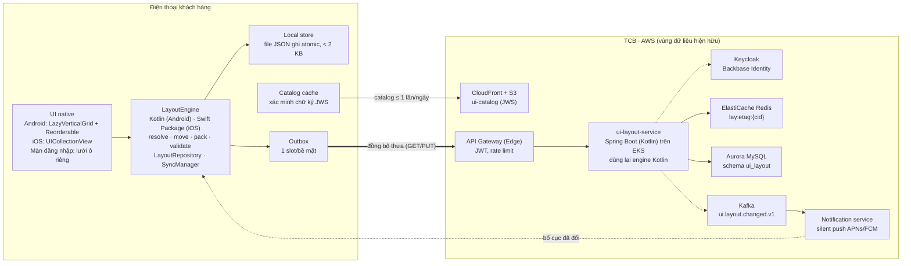
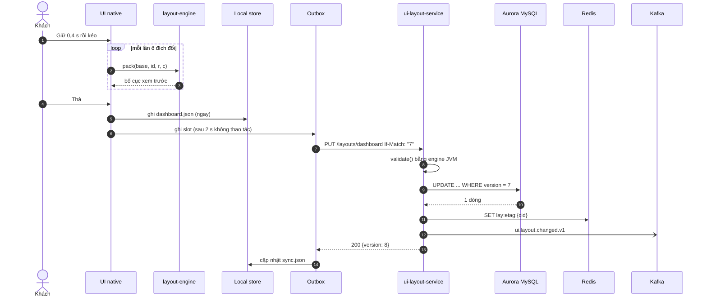
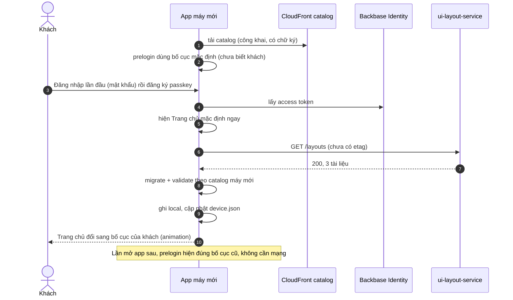

*TCB Mobile · ROC · HLD + LLD*

# Layout Sync: sắp xếp giao diện theo từng khách hàng, giữ nguyên khi đổi máy

Kiến trúc cho tính năng kéo thả sắp xếp màn đăng nhập, Trang chủ và thanh menu dưới trên Android và iOS. Bố cục hiện ngay từ máy, không chờ mạng; đồng bộ lên server để khách đổi máy (kể cả iOS sang Android) vẫn giữ được; chi phí hạ tầng thêm gần như không đáng kể.

**Phạm vi** Prelogin, Dashboard, Dock · **Nền tảng** Android, iOS · **Phiên bản** 1.0 · 17/11/2026 · **Trạng thái** Đề xuất

## Quyết định chính

Năm lựa chọn quyết định tốc độ, chi phí và độ nhất quán giữa hai nền tảng.

- **Client · Native: Trang chủ dùng lưới cuộn lazy có sẵn kéo-đổi-chỗ, màn đăng nhập dùng lưới ô cố định.** Android: LazyVerticalGrid + thư viện Reorderable. iOS: UICollectionView với kéo đổi chỗ tích hợp. Chỉ vẽ widget đang hiện trên màn, nên Trang chủ dài vẫn mượt. Màn đăng nhập không cuộn nên dùng lưới ô tự viết, cho phép để trống.
- **Đồng bộ · Local-first: máy là nơi hiển thị, server là bản lưu gốc.** Mở app đọc bố cục từ file local, 0 request mạng trên đường hiển thị. Server chỉ dùng để sao lưu và khôi phục khi đổi máy.
- **Dữ liệu · Chỉ lưu ID và toạ độ, chỉ lưu khi khách đã tuỳ chỉnh.** Bản bố cục khoảng 0,5–1,5 KB, không chứa link, nhãn hay số tiền. Khách chưa đổi gì thì không có bản ghi nào; app dùng mặc định từ catalog.
- **Server · Một microservice nhỏ, dùng lại Aurora MySQL, Redis, Kafka sẵn có.** `ui-layout-service` trên EKS, tách khỏi Backbase để không bị kéo theo khi thay thế Backbase.
- **Cấu hình mặc định · Catalog widget là file JSON ký số trên S3 + CloudFront.** Đổi bố cục mặc định theo phân khúc, thêm widget mới, tắt khẩn cấp mà không cần phát hành app. Không tốn tài nguyên server.
- **Tiết kiệm request · Kiểm tra thay đổi tối đa 1 lần/ngày, có push báo khi máy khác sửa.** Không gọi API layout ở mỗi lần đăng nhập. Với 50–65 triệu lượt đăng nhập/ngày, đây là khác biệt giữa hàng chục triệu request và vài chục nghìn.

## Yêu cầu và mục tiêu

| Nhóm      | Yêu cầu                                                                             | Chỉ tiêu                                                  |
|-----------|-------------------------------------------------------------------------------------|-----------------------------------------------------------|
| Chức năng | Giữ rồi kéo để đổi chỗ widget, nút tắt, nút menu; thêm/bỏ mục; khôi phục mặc định   | Áp dụng cho 3 bề mặt: prelogin, dashboard, dock           |
| Đổi máy   | Khách đăng nhập trên máy mới (cùng hoặc khác hệ điều hành) thấy lại bố cục của mình | Có bố cục ngay sau lần đăng nhập đầu tiên trên máy mới    |
| Tốc độ    | Không chặn hiển thị vì mạng; kéo thả mượt                                           | Đọc local < 10 ms · kéo 60–120 fps · API p99 < 50 ms    |
| Chi phí   | Không tạo tải đáng kể so với 50–65 triệu lượt đăng nhập/ngày                        | ≤ 0,2 request layout trung bình mỗi khách mỗi ngày        |
| Nhất quán | Android và iOS cho cùng kết quả xếp ô với cùng thao tác                             | Cùng một bộ test vector chạy trên Android, iOS và server  |
| An toàn   | Không lộ dữ liệu tài chính ở màn chưa đăng nhập; không cho tiêm link lạ qua bố cục  | Bố cục chỉ chứa ID; link và nhãn lấy từ catalog có chữ ký |
| Vận hành  | Tắt tính năng hoặc ép bố cục mặc định cho toàn bộ khách mà không phát hành app      | Hiệu lực trong ≤ 15 phút (TTL catalog)                    |

## Các app làm thế nào

Khảo sát màn hình chính iOS và Android, các app ngân hàng và ví có tuỳ chỉnh trang chủ, và các API kéo thả mới nhất. Cột cuối là điều Layout Sync lấy về.

| App / nền tảng                                   | Cách làm                                                                                                                                                                                                                                                                     | Áp dụng cho TCB                                                                                                     |
|--------------------------------------------------|------------------------------------------------------------------------------------------------------------------------------------------------------------------------------------------------------------------------------------------------------------------------------|---------------------------------------------------------------------------------------------------------------------|
| **iPhone (iOS 18+)**                             | Lưới 4 cột cố định. Giữ lâu để vào chế độ sửa: biểu tượng rung, có dấu − để bỏ. Thả ra thì tự bám ô gần nhất và được để ô trống. Kéo nhiều mục bằng ngón thứ hai.                                                                                                            | Màn đăng nhập: lưới ô cố định, cho phép ô trống, dấu − ở chế độ sửa.                                                |
| **Android Launcher3** (launcher gốc của Android) | Thuật toán xếp lại tách khỏi lớp hiển thị, có unit test riêng. Khi ngón tay rê lên ô đang có mục, mục bị ảnh hưởng nhích nhẹ ngay để báo trước, nhưng phải dừng ~350 ms mới thực sự dời chỗ. Các mục chuyển động lệch nhau 0–60 ms. Mọi thay đổi chỉ là tạm cho tới khi thả. | Trễ 350 ms trước khi dời chỗ để kéo lướt qua nhiều ô không làm cả màn giật. Engine là hàm thuần, test được độc lập. |
| **UBS Mobile Banking**                           | Giữ widget rồi kéo trực tiếp. Giữ và chọn "Remove widget" để bỏ. Nút "Edit home screen" ở cuối trang chủ để thêm widget.                                                                                                                                                     | Ngoài cử chỉ giữ, có nút "Tuỳ chỉnh" cố định ở cuối Trang chủ cho người không biết cử chỉ.                          |
| **NatWest**                                      | Hai cách sắp xếp: giữ rồi kéo, hoặc vào chế độ sửa và dùng mũi tên lên/xuống. Chỉ hiện widget mà khách đủ điều kiện dùng. Một số widget giới hạn tối đa 3 mục.                                                                                                               | Mũi tên lên/xuống là phương án thay thế bắt buộc cho người không kéo được. Catalog lọc widget theo quyền.           |
| **Monzo**                                        | Trang chủ mới dựng theo kiến trúc server-driven. Phần tuỳ chỉnh ra đời từ nghiên cứu với hơn 1.000 khách. Triển khai qua 4 thử nghiệm lớn và 2 nhỏ trong 7 tháng tới hơn 8 triệu khách.                                                                                      | Bật theo cờ trong catalog và đo A/B trước khi mở cho toàn bộ khách.                                                 |
| **Alipay**                                       | Cho bật/tắt từng khối trang chủ, giữ cố định quét mã và thu/chi. Bài viết phân tích chỉ ra lỗi: tắt hết thẻ thì app lại ép hiện lời nhắc thêm thẻ, gây khó chịu.                                                                                                             | Khối cốt lõi (nút đăng nhập, nút QR) không bỏ được. Khách bỏ hết widget thì để trống, không nhắc lại.               |
| **Airbnb Ghost Platform**                        | Bố cục tham chiếu section bằng ID thay vì nhúng nội dung, giúp phản hồi nhỏ và tái dùng section.                                                                                                                                                                             | Bố cục chỉ lưu ID; nội dung widget tải riêng.                                                                       |
| **Revolut 10**                                   | Thêm widget, đổi theme, nền riêng cho từng tài khoản, tuỳ chỉnh thanh điều hướng. Bài công bố không mô tả cách sắp xếp.                                                                                                                                                      | Tham khảo phạm vi tuỳ chỉnh; không có chi tiết kỹ thuật.                                                            |

### Công nghệ nền tảng đang có

| Nền tảng          | Công cụ                                                                                                                                                                                                                                                                   | Phù hợp với                                               |
|-------------------|---------------------------------------------------------------------------------------------------------------------------------------------------------------------------------------------------------------------------------------------------------------------------|-----------------------------------------------------------|
| Android           | **Reorderable** (Calvin-LL, Apache-2.0, bản 3.1.0): kéo đổi chỗ cho LazyColumn, LazyVerticalGrid, lưới so le. Có giữ-lâu-để-kéo, tự cuộn khi tới mép với tốc độ theo khoảng cách, animation bằng `Modifier.animateItem`. Rung không có sẵn, tự gọi `LocalHapticFeedback`. | Trang chủ cuộn dài                                        |
| iOS 27+           | SwiftUI mới có `reorderable()` và `reorderContainer(for:)` dùng được với mọi container (lazy grid, layout tự viết); hệ thống lo ảnh kéo, chỗ chèn, animation thả.                                                                                                         | Hướng lâu dài, khi phiên bản iOS tối thiểu của app lên 27 |
| iOS mọi phiên bản | **UICollectionView** + diffable data source, kéo đổi chỗ tương tác có sẵn, tái dùng cell nên cuộn mượt.                                                                                                                                                                   | Trang chủ cuộn dài, chạy trên mọi iOS app đang hỗ trợ     |
| Cả hai            | Cử chỉ giữ-kéo tự viết (`detectDragGesturesAfterLongPress`, `LongPressGesture.sequenced(DragGesture)`) trên lưới ô tự viết.                                                                                                                                               | Màn đăng nhập: không cuộn nên không vướng xung đột cử chỉ |

### Quy tắc UX áp dụng

| Quy tắc                    | Chi tiết                                                                                                                                                | Nguồn                  |
|----------------------------|---------------------------------------------------------------------------------------------------------------------------------------------------------|------------------------|
| Vào chế độ kéo             | Giữ theo thời gian long-press mặc định của hệ thống (~400–500 ms), rung nhẹ khi khối nhấc lên. Ảnh kéo hơi trong suốt, phóng 1,03–1,05 lần, có bóng.    | Apple HIG              |
| Chống giật khi kéo lướt    | Lưới ô màn đăng nhập: ô đích đổi thì mục bị ảnh hưởng nhích nhẹ ngay; chỉ dời chỗ thật khi ngón tay dừng ở đó ~350 ms.                                  | Launcher3              |
| Báo chỗ thả hợp lệ         | Tô sáng ô đích khi thả được. Thả vào chỗ không hợp lệ thì khối bay về chỗ cũ.                                                                           | Apple HIG              |
| Tự cuộn                    | Kéo tới gần mép trên/dưới thì cuộn, càng sát mép càng nhanh; dừng cuộn khi ra khỏi vùng lưới.                                                           | Apple HIG, Reorderable |
| Hoàn tác                   | Sau khi thả hiện thông báo ngắn "Đã đổi chỗ · Hoàn tác" khoảng 4 giây.                                                                                  | Apple HIG              |
| Không dùng được cử chỉ kéo | Chế độ sửa có mũi tên lên/xuống cho từng mục. VoiceOver/TalkBack có hành động "Di chuyển lên", "Di chuyển xuống", đọc to vị trí mới sau mỗi lần chuyển. | WCAG 2.5.7, NatWest    |
| Dễ tìm thấy                | Ngoài cử chỉ giữ, có nút "Tuỳ chỉnh" ở cuối Trang chủ.                                                                                                  | UBS, NatWest           |
| Giữ phần cốt lõi           | Nút đăng nhập, nút QR ở thanh dưới không bỏ được. Bỏ hết widget thì không nhắc lại.                                                                     | Alipay                 |

## HLD · Kiến trúc tổng thể

Ba đường dữ liệu tách biệt: hiển thị (chỉ trong máy), đồng bộ (máy ↔ server, rất thưa), cấu hình mặc định (CDN, dùng chung cho mọi khách).



*Đường đậm: đồng bộ có xác thực, chỉ chạy khi cần. Đường nét đứt: bất đồng bộ; mất tin không làm sai dữ liệu vì có kiểm tra định kỳ 24 giờ bù lại.*

### Vai trò từng thành phần

| Thành phần                         | Trách nhiệm                                                                                                                                             | Không làm                                                   |
|------------------------------------|---------------------------------------------------------------------------------------------------------------------------------------------------------|-------------------------------------------------------------|
| **UI native**                      | Nhận cử chỉ, vẽ lưới ô, animation dời chỗ, rung, tự cuộn khi kéo tới mép                                                                                | Không tự tính vị trí; mọi quyết định xếp ô gọi xuống engine |
| **LayoutEngine (Kotlin / Swift)**  | Giải bố cục (bố cục đã lưu + catalog + quyền theo phân khúc), xếp ô khi kéo, dồn ô, tìm chỗ trống, kiểm tra hợp lệ, chuyển đổi schema, tuần tự hoá JSON | Không gọi UI, không biết gì về Compose/SwiftUI              |
| **LayoutRepository + SyncManager** | Đọc/ghi local, outbox, chính sách kiểm tra thay đổi, xử lý xung đột                                                                                     | Không chặn luồng hiển thị chờ mạng                          |
| **ui-layout-service**              | Lưu bản gốc theo khách, ETag, khoá lạc quan theo version, kiểm tra hợp lệ phía server, phát sự kiện                                                     | Không render, không trả link hay nhãn                       |
| **Catalog (S3 + CloudFront)**      | Danh mục widget, kích thước cho phép, phiên bản app tối thiểu, bố cục mặc định theo phân khúc, cờ tắt khẩn cấp                                          | Không chứa dữ liệu khách hàng                               |

## Công nghệ sử dụng

Chỉ liệt kê những gì dùng. Phần server dùng lại hạ tầng TCB đang vận hành; chỉ thêm một service nhỏ.

| Hạng mục               | Công nghệ                                                                                                                 | Vai trò                                                                                                                                                                                                                                                |
|------------------------|---------------------------------------------------------------------------------------------------------------------------|--------------------------------------------------------------------------------------------------------------------------------------------------------------------------------------------------------------------------------------------------------|
| Trang chủ Android      | Jetpack Compose `LazyVerticalGrid` + Reorderable (Apache-2.0)                                                             | Lưới 4 cột: widget chiếm cả hàng, nút tắt chiếm 1 ô. Chỉ dựng widget đang hiện. Kéo đổi chỗ, tự cuộn, animation có sẵn. Thư viện qua rà soát bảo mật và giấy phép theo quy trình phụ thuộc bên thứ ba; nếu không đạt thì đưa mã nguồn vào repo nội bộ. |
| Trang chủ iOS          | `UICollectionView` compositional layout + diffable data source                                                            | Kéo đổi chỗ tương tác, tái dùng cell. Nhúng vào màn SwiftUI qua `UIViewControllerRepresentable` nếu Trang chủ viết bằng SwiftUI. Khi app bỏ hỗ trợ iOS dưới 27, chuyển sang `reorderable()` của SwiftUI.                                               |
| Màn đăng nhập (cả hai) | Compose `Layout` tự viết · SwiftUI `Layout` tự viết                                                                       | Lưới 4×10 ô cố định, cho phép ô trống. Không cuộn nên cử chỉ giữ-kéo tự viết không vướng xung đột với cuộn.                                                                                                                                            |
| Thanh menu dưới        | Cùng cơ chế màn đăng nhập, 1 hàng 4 ô                                                                                     | Nút QR ở giữa cố định.                                                                                                                                                                                                                                 |
| Layout engine          | Module Kotlin thuần (Android, server) · Swift Package (iOS)                                                               | Giải bố cục từ catalog và tài liệu đã lưu, kiểm tra hợp lệ, chuyển đổi schema, thuật toán ô cho màn đăng nhập.                                                                                                                                         |
| Chống lệch Android/iOS | Đặc tả thuật toán chung, repo test vector `layout-spec`, differential test trên CI                                        | Một bộ test vector chạy trên Android, iOS và server; mỗi đêm so kết quả hai engine.                                                                                                                                                                    |
| Lưu trên máy           | Android: DataStore · iOS: file trong Application Support, ghi atomic                                                      | 3 tài liệu nhỏ mỗi khách, đọc trước khung hình đầu.                                                                                                                                                                                                    |
| Rung, trợ năng         | Android: `HapticFeedback`, `semantics { customActions }` · iOS: `UIImpactFeedbackGenerator`, `accessibilityCustomActions` | Theo quy tắc UX ở trên.                                                                                                                                                                                                                                |
| Service                | Spring Boot (Kotlin) trên EKS: `ui-layout-service`                                                                        | Lưu và trả bố cục, khoá lạc quan theo version, kiểm tra hợp lệ bằng engine Kotlin. Đứng riêng ngoài Backbase.                                                                                                                                          |
| Lưu trữ server         | Aurora MySQL (cụm sẵn có, schema mới)                                                                                     | Bảng thưa: chỉ khách đã tuỳ chỉnh mới có dòng.                                                                                                                                                                                                         |
| Cache                  | ElastiCache Redis sẵn có                                                                                                  | Trả 304 cho lần kiểm tra định kỳ mà không chạm DB.                                                                                                                                                                                                     |
| Sự kiện, push          | Kafka sẵn có + Notification service (APNs/FCM)                                                                            | Báo các máy khác của khách khi bố cục đổi.                                                                                                                                                                                                             |
| Bố cục mặc định        | S3 + CloudFront, JSON ký JWS                                                                                              | Catalog widget, mặc định theo phân khúc, cờ tắt khẩn cấp; đọc được trước khi đăng nhập.                                                                                                                                                                |

## LLD · Thiết kế chi tiết

### 1. Mô hình dữ liệu LayoutDoc

Mỗi khách có tối đa 3 tài liệu, một cho mỗi bề mặt. Tài liệu chỉ chứa ID trong catalog; nhãn, icon, deep link và số liệu không bao giờ nằm trong tài liệu. Hai kiểu bố cục:

**Trang chủ và thanh menu: danh sách có thứ tự**

```json
{
  "schema": 1,
  "surface": "dashboard",
  "order":  ["search", "hero", "sec.todo",
             "tile.cards", "tile.wealth", "sec.tx"],
  "hidden": ["sec.rates"],
  "parked": [],
  "segmentAtSave": "PRIORITY",
  "catalogVer": "2026.11.3",
  "updatedAt": "2026-11-17T09:12:44.120Z"
}
```

Kích thước lấy từ catalog: widget chiếm cả hàng, nút tắt chiếm 1 ô; các nút tắt liền nhau tự xếp chung một hàng. Không lưu toạ độ, nên máy màn hình rộng (máy gập, tablet) tự xếp nhiều cột mà không cần bố cục riêng.

**Màn đăng nhập: lưới ô cố định**

```json
{
  "schema": 1,
  "surface": "prelogin",
  "grid": { "cols": 4, "rows": 10 },
  "cells": [
    { "id": "sys.login", "w": 4, "h": 1, "r": 0, "c": 0 },
    { "id": "sys.logo",  "w": 2, "h": 1, "r": 1, "c": 0 },
    { "id": "sec.card",  "w": 4, "h": 2, "r": 2, "c": 0 },
    { "id": "tile.qr",   "w": 1, "h": 1, "r": 8, "c": 0 }
  ],
  "hidden": ["sec.extra"],
  "catalogVer": "2026.11.3"
}
```

Lưu toạ độ ô vì màn này cho phép để trống ô, giống màn hình chính iPhone.

| Trường        | Quy tắc                                                                                                                                     |
|---------------|---------------------------------------------------------------------------------------------------------------------------------------------|
| ID            | Khớp `^[a-z]+\.[a-z0-9_]{1,32}$`, có trong catalog. Tiền tố: `sec.` widget, `tile.` nút tắt, `sys.` khối hệ thống.                          |
| `cells`       | Không chồng nhau, trong biên 4×10, kích thước nằm trong danh sách catalog cho phép.                                                         |
| `parked`      | ID mà app phiên bản cũ không hiểu: giữ nguyên, không xoá; app mới đọc thì xếp lại. Tránh mất dữ liệu khi khách dùng hai máy khác phiên bản. |
| Khối bắt buộc | `sys.login` (màn đăng nhập), `sys.qr` (thanh menu) không xoá được; thiếu thì engine tự chèn.                                                |
| Giới hạn      | ≤ 64 mục, ≤ 8 KB.                                                                                                                           |

### 2. Layout engine (Kotlin và Swift)

Hai thư viện thuần, không I/O, không phụ thuộc UI: module Kotlin `:layout-engine` không dùng Android SDK (server dùng lại nguyên file JAR), và Swift Package `TCBLayoutEngine`. Cùng tên hàm, cùng kiểu dữ liệu, cùng thuật toán theo đặc tả. Phần lớn logic là thao tác danh sách; thuật toán ô chỉ dùng cho màn đăng nhập.

```kotlin
// Android · :layout-engine (Kotlin/JVM thuần)
object LayoutEngine {
  // Trang chủ, thanh menu
  fun resolveFlow(doc: FlowDoc?, catalog: Catalog,
                  ctx: RenderCtx): List<Slot>
  fun move(order: List<String>, from: Int, to: Int,
           catalog: Catalog): List<String>
  // Màn đăng nhập
  fun resolveCells(doc: CellDoc?, catalog: Catalog,
                   ctx: RenderCtx): Placement
  fun pack(base: Placement, id: String, r: Int, c: Int,
           spec: GridSpec): Placement?
  fun firstFree(p: Placement, w: Int, h: Int,
                spec: GridSpec): Cell?
  // Chung
  fun validate(doc: LayoutDoc, catalog: Catalog): List<Violation>
  fun migrate(json: JsonObject): LayoutDoc
}
```

```swift
// iOS · TCBLayoutEngine (Swift Package)
public enum LayoutEngine {
  public static func resolveFlow(_ doc: FlowDoc?, catalog: Catalog,
                                 ctx: RenderCtx) -> [Slot]
  public static func move(_ order: [String], from: Int, to: Int,
                          catalog: Catalog) -> [String]
  public static func resolveCells(_ doc: CellDoc?, catalog: Catalog,
                                  ctx: RenderCtx) -> Placement
  public static func pack(_ base: Placement, id: String, r: Int,
                          c: Int, spec: GridSpec) -> Placement?
  public static func firstFree(_ p: Placement, w: Int, h: Int,
                               spec: GridSpec) -> Cell?
  public static func validate(_ doc: LayoutDoc,
                              catalog: Catalog) -> [Violation]
  public static func migrate(_ data: Data) throws -> LayoutDoc
}
```

**Thuật toán `pack` (màn đăng nhập)**

1.  Đặt khối đang kéo vào ô đích.
2.  Duyệt các khối còn lại theo thứ tự đọc của vị trí cũ. Mỗi khối giữ cột, tìm hàng trống đầu tiên từ hàng cũ trở xuống.
3.  Có khối vượt hàng 10 thì trả `null`: UI giữ bản xem trước hợp lệ gần nhất và báo không thả được.

Với tối đa 64 khối, mỗi lần gọi dưới 0,1 ms.

**Máy trạng thái kéo thả**

```text
Idle
 └─ chạm ─▶ Pressing (long-press hệ thống)
      ├─ di > 9 dp / nhấc tay ─▶ Idle (cuộn / chạm thường)
      └─ đủ giờ ─▶ Lifted (rung, nổi khối)
           ├─ nhấc tay, không di ─▶ EditMode (rung lắc, nút −)
           └─ di ─▶ Dragging
                ├─ ô đích đổi ─▶ Hint (nhích ngay)
                │     └─ dừng 350 ms ─▶ Reflow (dời chỗ thật)
                ├─ nhấc tay ─▶ Dropping ─▶ Commit + "Hoàn tác"
                └─ hệ thống huỷ ─▶ Revert
```

**Ba lớp chống lệch logic giữa hai bản**

1.  **Đặc tả thuật toán là nguồn duy nhất.** Mã giả của `move`, `pack`, `firstFree`, thứ tự duyệt, cách làm tròn toạ độ ngón tay nằm trong Feature Design Spec chung. Hai đội code theo đặc tả, không suy ra từ code của nhau.
2.  **Bộ test vector chung** trong repo `layout-spec` (Android qua Gradle, iOS qua SPM, server qua Maven). Cả hai app và server phải qua 100%; gặp trường hợp biên thì thêm vector trước khi sửa code.
3.  **Differential test trên CI mỗi đêm**: sinh khoảng 10.000 chuỗi thao tác ngẫu nhiên, chạy engine Kotlin trên JVM và engine Swift trên runner macOS, so từng vị trí. Lệch là CI đỏ và tự tạo vector mới.

```json
// layout-spec/vectors/prelogin-push-down-003.json
{ "spec": { "cols": 4, "rows": 10 },
  "base": [ {"id":"sys.logo","w":2,"h":1,"r":0,"c":0}, {"id":"sys.tools","w":2,"h":1,"r":0,"c":2},
            {"id":"sec.greet","w":4,"h":2,"r":1,"c":0}, {"id":"sec.card","w":4,"h":2,"r":3,"c":0},
            {"id":"sec.extra","w":4,"h":1,"r":5,"c":0}, {"id":"tile.qr","w":1,"h":1,"r":8,"c":0},
            {"id":"sys.login","w":4,"h":1,"r":9,"c":0} ],
  "op":   { "pack": { "id": "sys.login", "r": 0, "c": 0 } },
  "expect": [ {"id":"sys.login","r":0,"c":0}, {"id":"sys.logo","r":1,"c":0}, {"id":"sys.tools","r":1,"c":2},
              {"id":"sec.greet","r":2,"c":0}, {"id":"sec.card","r":4,"c":0}, {"id":"sec.extra","r":6,"c":0},
              {"id":"tile.qr","r":8,"c":0} ] }
```

### 3. UI kéo thả trên từng nền tảng

**Android: Trang chủ**

```kotlin
val gridState = rememberLazyGridState()
val reorder = rememberReorderableLazyGridState(gridState) { from, to ->
  vm.move(from.key as String, to.key as String)   // gọi LayoutEngine.move
  haptic.performHapticFeedback(HapticFeedbackType.SegmentFrequentTick)
}
LazyVerticalGrid(columns = GridCells.Fixed(4), state = gridState) {
  items(slots, key = { it.id }, span = { GridItemSpan(it.span) }) { slot ->
    ReorderableItem(reorder, key = slot.id) { dragging ->
      WidgetHost(slot,
        Modifier.longPressDraggableHandle(
          onDragStarted = { haptic.performHapticFeedback(HapticFeedbackType.LongPress) },
          onDragStopped = { vm.commitAndOfferUndo() })
        .semantics { customActions = vm.moveActions(slot) }
        .graphicsLayer { if (dragging) { scaleX = 1.04f; scaleY = 1.04f; shadowElevation = 16f } })
    }
  }
}
```

Reorderable dời chỗ ngay khi khối kéo qua mục khác. Với Trang chủ (chủ yếu widget chiếm cả hàng) như vậy là đủ mượt; trễ 350 ms kiểu Launcher3 chỉ áp dụng cho lưới ô dày ở màn đăng nhập. Spike giai đoạn 0 kiểm chứng điều này.

**iOS: Trang chủ**

```swift
// UICollectionView + diffable data source
let lp = UILongPressGestureRecognizer(target: self, action: #selector(onLongPress))
lp.minimumPressDuration = 0.45
collectionView.addGestureRecognizer(lp)

@objc func onLongPress(_ g: UILongPressGestureRecognizer) {
  let p = g.location(in: collectionView)
  switch g.state {
  case .began:
    guard let ip = collectionView.indexPathForItem(at: p) else { return }
    lift.impactOccurred()
    collectionView.beginInteractiveMovementForItem(at: ip)
  case .changed: collectionView.updateInteractiveMovementTargetPosition(p)
  case .ended:   collectionView.endInteractiveMovement(); vm.commitAndOfferUndo()
  default:       collectionView.cancelInteractiveMovement()
  }
}
// dataSource.reorderingHandlers.didReorder = { tx in vm.apply(tx.difference) }
```

Trợ năng: mỗi cell có `accessibilityCustomActions` "Di chuyển lên/xuống", sau mỗi lần chuyển gửi `UIAccessibility.post(.announcement, …)` đọc vị trí mới.

**Màn đăng nhập (cả hai nền tảng):** lưới ô tự viết, như prototype. Khối đang kéo chỉ cập nhật toạ độ theo ngón tay; các khối khác chỉ đổi khi `pack()` trả kết quả mới sau 350 ms dừng, nên không dựng lại cả màn mỗi khung hình. Android dùng `detectDragGesturesAfterLongPress` + `animateIntOffsetAsState`; iOS dùng `LongPressGesture.sequenced(before: DragGesture())` + `withAnimation(.snappy)`.

> Tốc độ: Trang chủ chỉ dựng widget đang nằm trên màn hình (lazy grid / cell reuse). Bố cục hiện ngay từ file local; nội dung từng widget tải riêng và hiện giá trị cache trước, nên thứ tự widget không bao giờ chờ mạng.

### 4. Lưu local và outbox

```text
files/layout/{cidHash}/prelogin.json     # bản đang dùng
files/layout/{cidHash}/dashboard.json
files/layout/{cidHash}/dock.json
files/layout/{cidHash}/sync.json         # { serverVersion per surface, etag, lastCheckAt, catalogVer }
files/layout/{cidHash}/outbox/{surface}.json   # 1 slot/bề mặt; ghi đè = tự gộp
files/layout/device.json                 # cidHash của khách đăng nhập gần nhất (cho prelogin)
```

- `cidHash` = HMAC-SHA256(mã khách hàng, khoá thiết bị trong Keystore/Keychain), cắt 16 ký tự. Không lưu mã khách hàng dạng rõ trong tên file.
- Prelogin đọc `device.json` để biết bố cục của ai, rồi đọc file tương ứng. Máy dùng chung cho nhiều khách thì mỗi khách một thư mục.
- Sau mỗi lần thả: ghi file chính ngay (giao diện đã đổi), sau 2 giây không thao tác thì ghi outbox và đẩy lên server. Kéo liên tục 10 lần chỉ sinh 1 request.
- JSON: `kotlinx.serialization` trên Android, `Codable` trên iOS, cùng tên trường theo đặc tả. Gọi API qua lớp network sẵn có của từng app (interceptor xác thực, pinning, log).
- Gửi outbox: Android dùng WorkManager (điều kiện có mạng, backoff mũ, tối đa 24 giờ). iOS gửi khi app ở foreground và thử lại mỗi lần app quay lại foreground; không cần chạy nền.
- iOS đặt `FileProtectionType.completeUntilFirstUserAuthentication` cho thư mục layout để màn đăng nhập đọc được ngay cả khi app được mở lại sau khi máy đã mở khoá lần đầu.
- Không mã hoá thêm: file không chứa dữ liệu tài chính. Có thể nằm trong sao lưu iCloud/Google, nhưng không dựa vào đó để khôi phục.

### 5. API đồng bộ

Base path `/api/ui-layout/v1`, qua Edge Gateway hiện có. Xác thực bằng access token của Backbase Identity; mã khách hàng lấy từ claim trong token, không bao giờ từ body hay URL.

[TABLE]

**Chính sách kiểm tra thay đổi trên client** (đây là phần quyết định chi phí):

- Gọi `GET /layouts` sau khi Trang chủ đã hiện xong, chạy nền, chỉ khi một trong các điều kiện sau đúng: chưa từng đồng bộ trên máy này (máy mới, cài lại), lần kiểm tra cuối đã quá 24 giờ, hoặc vừa nhận silent push `layout_changed`.
- Nếu app đang có API khởi tạo sau đăng nhập (lấy hồ sơ hoặc cấu hình người dùng), có thể thêm trường `layoutEtag` vào đó và bỏ hẳn lần kiểm tra định kỳ. Cần đội Backbase/BFF xác nhận có điểm gắn phù hợp.

### 6. Luồng xử lý

**6.1 Khách sắp xếp lại Trang chủ**



**6.2 Khách đổi máy (kể cả iPhone sang Android)**



> Lần đầu trên máy mới, Trang chủ hiện mặc định trong khoảng thời gian một request (thường dưới 300 ms) rồi mới chuyển sang bố cục của khách. Nếu muốn không có bước chuyển này, chờ `GET /layouts` tối đa 400 ms trước khi vẽ Trang chủ, chỉ áp dụng khi máy chưa từng đồng bộ.

**6.3 Các luồng còn lại**

| Tình huống                         | Xử lý                                                                                                                                                                                                                        |
|------------------------------------|------------------------------------------------------------------------------------------------------------------------------------------------------------------------------------------------------------------------------|
| Mở app (cold start)                | Đọc catalog cache + file prelogin, gọi `resolve()`, vẽ. Không có request mạng nào trước khung hình đầu.                                                                                                                      |
| Xung đột (2 máy cùng sửa)          | PUT nhận 412 kèm bản trên server. Quy tắc: thao tác mới nhất của khách thắng theo từng bề mặt. Client PUT lại với version mới nhận được; bản bị ghi đè lưu vào `prev_doc`. Không trộn từng ô vì khách khó hiểu kết quả trộn. |
| Máy khác nhận thay đổi             | Kafka → Notification service gửi silent push tới các máy khác của khách. Máy nhận đánh dấu "cần kiểm tra", gọi `GET /layouts` ở lần foreground kế tiếp. Push bị mất thì lần kiểm tra 24 giờ sẽ bù.                           |
| Widget mới ra mắt                  | Catalog thêm ID mới kèm vị trí mặc định (Trang chủ: chèn sau một ID neo; màn đăng nhập: ô mặc định, bận thì ô trống gần nhất). Không sửa tài liệu của khách cho tới khi khách tự kéo.                                        |
| Widget bị gỡ                       | ID không còn trong catalog thì bỏ qua khi vẽ; Trang chủ là danh sách nên tự liền lại. Tài liệu giữ nguyên, lần lưu kế tiếp tự sạch.                                                                                          |
| Khách lên hạng (Normal → Priority) | Tài liệu theo bề mặt, không theo phân khúc. Widget không có quyền ở phân khúc mới thì ẩn; widget mới của phân khúc chèn theo mặc định.                                                                                       |
| Hai máy khác phiên bản app         | App cũ gặp ID lạ thì chuyển sang `parked`, không xoá. Server từ chối PUT có `schema` nhỏ hơn bản đang lưu, trừ khi client gửi kèm toàn bộ `parked`.                                                                          |
| Tắt khẩn cấp                       | Catalog đặt `layoutPolicy: "default"`: mọi app bỏ qua bố cục khách, vẽ mặc định, ẩn chức năng kéo. Dữ liệu khách giữ nguyên, bật lại là về như cũ.                                                                           |

### 7. Server, DB, cache, sự kiện

```sql
-- Aurora MySQL 8, schema ui_layout (đặt trên một cụm Tier 2 trong kế hoạch chia cụm mới)
CREATE TABLE customer_layout (
  customer_id   VARCHAR(40)       NOT NULL,
  surface       VARCHAR(16)       NOT NULL,          -- prelogin | dashboard | dock
  version       INT UNSIGNED      NOT NULL,
  schema_ver    SMALLINT UNSIGNED NOT NULL,
  doc           JSON              NOT NULL,
  prev_doc      JSON              NULL,               -- 1 bước khôi phục cho CSKH
  device_id     VARCHAR(64)       NULL,
  app_version   VARCHAR(20)       NULL,
  created_at    DATETIME(3)       NOT NULL DEFAULT CURRENT_TIMESTAMP(3),
  updated_at    DATETIME(3)       NOT NULL DEFAULT CURRENT_TIMESTAMP(3) ON UPDATE CURRENT_TIMESTAMP(3),
  PRIMARY KEY (customer_id, surface)
) ENGINE = InnoDB;

-- Cập nhật có khoá lạc quan: 0 dòng ảnh hưởng => trả 412
UPDATE customer_layout
   SET doc = ?, prev_doc = doc, schema_ver = ?, version = version + 1, device_id = ?, app_version = ?
 WHERE customer_id = ? AND surface = ? AND version = ?;

-- Tạo mới: trùng khoá => 412
INSERT INTO customer_layout (customer_id, surface, version, schema_ver, doc, device_id, app_version)
VALUES (?, ?, 1, ?, ?, ?, ?);
```

**Redis**

```text
lay:etag:{cid}  →  "p3.d7.k2"   # version từng bề mặt
                   "0"           # khách chưa tuỳ chỉnh (cache âm)
TTL 7 ngày, gia hạn khi đọc
Cache miss → SELECT surface, version → ghi lại
```

GET có `If-None-Match` trùng thì trả 304 ngay từ Redis. Ghi Redis sau khi commit DB; lỗi ghi Redis chỉ log, lần đọc sau tự nạp lại.

**Sự kiện Kafka** `ui.layout.changed.v1`, key = `customer_id`

```json
{ "customerId": "…", "surface": "dashboard",
  "version": 8, "deviceId": "…",
  "changed": ["sec.tx", "tile.cards"],
  "at": "2026-11-17T09:12:46Z" }
```

Phát sau commit, chấp nhận mất tin (không cần outbox pattern). Người dùng tin: Notification service (push tới máy khác) và analytics (nếu khách đồng ý xử lý dữ liệu cho mục đích phân tích).

**Service**: Spring Boot 3 (Kotlin), phụ thuộc artifact JVM của `layout-engine` để kiểm tra hợp lệ bằng đúng mã client dùng. Validation phía server: kích thước, số mục, ID có trong catalog (nạp từ S3, làm mới 5 phút), kích thước hợp lệ, không chồng ô, có đủ khối bắt buộc. 2 pod tối thiểu (0,5 vCPU, 1 GiB), HPA tới 6 pod theo CPU. Rate limit tại gateway: 30 PUT/phút/khách.

### 8. Catalog widget

```text
GET https://{cdn}/ui-catalog/v1/manifest.json     # TTL 15 phút, trỏ tới bản hiện hành
GET https://{cdn}/ui-catalog/v1/2026.11.3.json    # bất biến, TTL 1 năm

{ "ver": "2026.11.3", "layoutPolicy": "user",
  "items": {
    "sec.tx":     { "sizes": [[4,3],[4,4]], "segments": ["*"], "minApp": "9.0.0" },
    "tile.cards": { "sizes": [[1,1]], "segments": ["*"], "deeplink": "tcb://cards" },
    "sys.login":  { "sizes": [[4,1]], "required": true, "surfaces": ["prelogin"] } },
  "defaults": {
    "dashboard": { "NORMAL": [ { "id": "search", "r": 0, "c": 0 }, … ],
                   "PRIVATE": [ … ] } } }
# Toàn bộ file ký JWS (ES256), app nhúng khoá công khai; sai chữ ký → dùng bản cache cũ
```

Đội sản phẩm đổi bố cục mặc định theo phân khúc hoặc mở widget mới bằng cách phát hành file catalog qua pipeline có duyệt, không cần phát hành app.

## Bảo mật và tuân thủ

| Rủi ro                                        | Biện pháp                                                                                                                                                                                                                                                                                |
|-----------------------------------------------|------------------------------------------------------------------------------------------------------------------------------------------------------------------------------------------------------------------------------------------------------------------------------------------|
| Đọc/ghi bố cục của khách khác (IDOR)          | Mã khách hàng chỉ lấy từ claim của token đã xác thực. API không có tham số mã khách hàng.                                                                                                                                                                                                |
| Tiêm link giả qua bố cục                      | Tài liệu chỉ chứa ID. Deep link, nhãn, icon lấy từ catalog có chữ ký JWS. Server từ chối ID không có trong catalog.                                                                                                                                                                      |
| Catalog bị giả mạo trên đường truyền hoặc CDN | TLS + pinning sẵn có, thêm xác minh chữ ký JWS trong app. Khoá ký nằm trong KMS, chỉ pipeline phát hành dùng được.                                                                                                                                                                       |
| Lộ thông tin ở màn chưa đăng nhập             | Bố cục prelogin chỉ quyết định vị trí. Số dư vẫn ẩn mặc định và chỉ lấy qua cơ chế số dư nhanh hiện có, không qua Layout Sync.                                                                                                                                                           |
| Lạm dụng API                                  | Rate limit theo khách, giới hạn 8 KB/tài liệu, `Idempotency-Key` cho PUT.                                                                                                                                                                                                                |
| Dữ liệu cá nhân                               | Bố cục gắn mã khách hàng nên được coi là dữ liệu cá nhân theo Luật Bảo vệ dữ liệu cá nhân. Mục đích: cung cấp dịch vụ khách yêu cầu. Xoá khi đóng tài khoản (job lắng nghe sự kiện đóng tài khoản). Có trong dữ liệu xuất khi khách yêu cầu. Dùng cho phân tích chỉ khi khách đã đồng ý. |
| Log                                           | Không log nội dung tài liệu; chỉ log surface, version, kích thước, kết quả validate.                                                                                                                                                                                                     |
| Vị trí lưu trữ                                | Dùng cụm Aurora, Redis, Kafka đã được phê duyệt; không tạo kho dữ liệu khách hàng mới ngoài vùng hiện hữu.                                                                                                                                                                               |

## Tải và chi phí ước tính

Số liệu đầu vào là giả định để định cỡ, cần thay bằng số thật từ analytics trước khi chốt.

| Đại lượng               | Giả định                                                                 | Kết quả                                                 |
|-------------------------|--------------------------------------------------------------------------|---------------------------------------------------------|
| Lượt đăng nhập          | 50–65 triệu/ngày (số hiện tại)                                           | Không tạo request layout nào                            |
| Kiểm tra thay đổi (304) | ~10 triệu máy hoạt động/ngày, tối đa 1 lần/máy/ngày                      | ≤ 10 triệu/ngày · TB ~115 rps · đỉnh ~600 rps, từ Redis |
| Tải đầy đủ (200)        | Máy mới, cài lại, sửa trên máy khác                                      | ~30–60 nghìn/ngày                                       |
| Ghi (PUT)               | 2% khách hoạt động sửa mỗi ngày giai đoạn đầu, sau giảm còn ~0,2%        | ~200 nghìn/ngày lúc đầu (≈ 2–3 rps) → ~20 nghìn/ngày    |
| Dung lượng DB           | 30% của 18 triệu khách tuỳ chỉnh, 3 bề mặt, ~1 KB mỗi bản (gồm prev_doc) | ~16 GB                                                  |
| Redis                   | Khoá cho khách hoạt động trong 7 ngày, ~80 byte/khoá                     | ≤ 1,5 GB                                                |
| Catalog CDN             | Mỗi máy kiểm tra manifest 1 lần/ngày, file ~10–20 KB, cache tại máy      | ≤ 10 triệu request/ngày, gần như toàn bộ là cache hit   |

Nếu thay vào đó gọi API layout ở mỗi lần đăng nhập, tải sẽ là 50–65 triệu request/ngày (~700 rps trung bình, vài nghìn rps lúc đỉnh) chỉ để biết bố cục không đổi. Chính sách kiểm tra 24 giờ cộng push cắt khoảng 85% số request đó; gắn `layoutEtag` vào API khởi tạo sẵn có thì cắt gần hết. Phần hạ tầng thêm mới chỉ là 2–6 pod nhỏ; DB, cache, Kafka, CDN đều dùng lại.

## Giám sát và kiểm thử

### Chỉ số theo dõi

- Client: thời gian đọc + resolve bố cục khi mở app (p50/p95), số khung hình rơi khi kéo, tỉ lệ outbox gửi lỗi quá 24 giờ.
- Server: p99 GET/PUT, tỉ lệ 304, tỉ lệ 412 (xung đột), tỉ lệ 422 theo loại vi phạm, Redis hit rate.
- Sản phẩm: % khách có tuỳ chỉnh, widget nào hay được kéo lên đầu hoặc bị bỏ. Đưa vào hệ thống đo hiệu quả theo từng tính năng của TCB Mobile.
- Cảnh báo: 422 tăng đột biến sau phát hành app (dấu hiệu lệch schema giữa client và server).

### Kiểm thử

- **Bộ test vector chung** `layout-spec`: chạy trong unit test Android (JUnit), iOS (XCTest) và server. Cùng một file, ba nơi chạy.
- **Differential test hằng đêm**: sinh ngẫu nhiên khoảng 10.000 chuỗi thao tác, so kết quả engine Kotlin và engine Swift.
- **Property-based test** (Kotest trên Android, swift-testing có tham số trên iOS): sinh ngẫu nhiên nghìn chuỗi kéo thả, kiểm tra bất biến: không chồng ô, không mất mục, khối bắt buộc còn đủ.
- **Contract test** API giữa client và service.
- **E2E Appium** trên thiết bị thật: giữ-kéo, tự cuộn, đổi máy giả lập (xoá app, cài lại, đăng nhập).
- **Hiệu năng**: Macrobenchmark (Android), XCTest metrics (iOS) cho cold start và khung hình khi kéo.

## Lộ trình triển khai

Mỗi giai đoạn phát hành được và có giá trị riêng; cờ tắt nằm trong catalog từ giai đoạn 1.

| Giai đoạn              | Nội dung                                                                                                                                                                                                             | Kết quả                                    |
|------------------------|----------------------------------------------------------------------------------------------------------------------------------------------------------------------------------------------------------------------|--------------------------------------------|
| 0 · Spike              | Dựng thử Trang chủ trên Android (LazyVerticalGrid + Reorderable) và iOS (UICollectionView) với 15 widget thật; đo khung hình khi kéo và khi cuộn trên máy cấu hình thấp nhất cần hỗ trợ; thử với VoiceOver/TalkBack. | Chốt thư viện, ngưỡng 350 ms và long-press |
| 1 · Engine + local     | Đặc tả thuật toán và bộ test vector viết trước; engine Kotlin và Swift làm song song; kéo thả Trang chủ, mũi tên lên/xuống, hoàn tác, lưu local. Catalog tĩnh trên CDN. Bật cho một nhóm khách để đo A/B.            | Khách sắp xếp được, chưa giữ khi đổi máy   |
| 2 · Đồng bộ            | `ui-layout-service`, bảng DB, Redis, outbox, khôi phục khi đổi máy.                                                                                                                                                  | Đổi máy giữ bố cục                         |
| 3 · Prelogin + dock    | Mở rộng sang màn đăng nhập (thu hẹp theo kết quả so sánh với Option 17) và thanh menu dưới.                                                                                                                          | Đủ 3 bề mặt                                |
| 4 · Đa máy + analytics | Kafka, silent push, số liệu widget cho đội sản phẩm.                                                                                                                                                                 | Đồng bộ giữa các máy đang dùng song song   |

## Giả định cần chốt

1.  Trang chủ iOS hiện viết bằng UIKit hay SwiftUI, và phiên bản iOS thấp nhất app hỗ trợ (màn đăng nhập dùng SwiftUI `Layout` cần iOS 16).
2.  Thư viện Reorderable có qua được rà soát phụ thuộc bên thứ ba của ngân hàng không; nếu không thì đưa mã nguồn vào repo nội bộ.
3.  Có API khởi tạo sau đăng nhập nào gắn thêm `layoutEtag` được không (để bỏ lần kiểm tra định kỳ).
4.  Notification service hiện tại có gửi silent push (APNs content-available, FCM data message) được không.
5.  Đặt schema `ui_layout` ở cụm Aurora nào trong kế hoạch chia 8 cụm mới.
6.  Số máy hoạt động mỗi ngày và tỉ lệ đổi máy thực tế, để thay các giả định ở phần tải.
7.  Backbase có module lưu tuỳ chọn người dùng dùng được không; nếu có, so sánh với service riêng theo tiêu chí phụ thuộc khi thay thế Backbase.
8.  Cơ sở pháp lý và màn hình xin đồng ý cho phần analytics widget, theo quy trình bảo vệ dữ liệu cá nhân của ngân hàng.

**Nguồn khảo sát**

- [AppleInsider: How iOS 18 lets you rearrange app icons and widgets](https://appleinsider.com/articles/24/06/11/how-ios-18-lets-you-neatly-rearrange-app-icons-and-home-screen-widgets)
- [Launcher3: Adding reorder hinting (REORDER_TIMEOUT 350 ms)](https://android.googlesource.com/platform/packages/apps/Launcher3/+/fa3c58f%5E%21/) · [Launcher3: ReorderAlgorithm tách khỏi lớp hiển thị](https://gerrit.omnirom.org/plugins/gitiles/android_packages_apps_Launcher3/+/6336f9bca39420b2fa8d43f6100cb2e846af0afb%5E%21)
- [UBS: Organize your home screen](https://www.ubs.com/ch/en/help/mobile-banking/organize-home-screen.html) · [NatWest: What is the Widgets feature](https://www.natwest.com/support-centre/banking-from-home/how-to-use-the-mobile-app/what-is-the-widgets-feature.html)
- [Monzo: How we built the new home screen](https://www.monzo.com/blog/how-we-built-the-new-home-screen) · [Revolut 10](https://www.revolut.com/blog/post/revolut-10/) · [Woshipm: phân tích tuỳ chỉnh trang chủ Alipay](https://www.woshipm.com/pd/5392000.html)
- [Airbnb: A Deep Dive into Airbnb’s Server-Driven UI System](https://medium.com/airbnb-engineering/a-deep-dive-into-airbnbs-server-driven-ui-system-842244c5f5)
- [Calvin-LL/Reorderable](https://www.github.com/Calvin-LL/Reorderable) · [Nil Coalescing: New SwiftUI APIs for reordering on iOS 27](https://www.nilcoalescing.com/blog/NewSwiftUIAPIsForReorderingAndDragAndDropOniOS27)
- [Apple HIG: Drag and drop](https://developer.apple.com/design/human-interface-guidelines/drag-and-drop) · [W3C G219: single-pointer alternative for dragging](https://www.w3.org/WAI/WCAG22/Techniques/general/G219) · [Inclusive Android Apps: drag and drop](https://buttondown.com/inclusive-android-apps/archive/inclusive-android-apps-5-the-problem-of-drag-and-and-drop/)

Tài liệu đề xuất cho ROC · Số liệu tải là ước tính để định cỡ.
